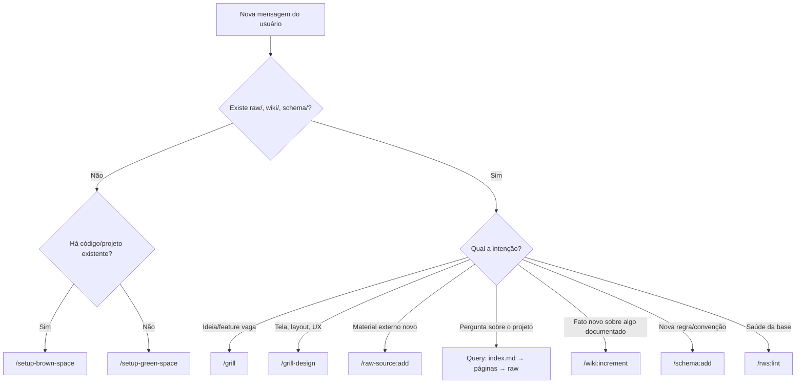

# Router do Agente — "Qual skill eu uso?"

Leia de cima para baixo e **pare na primeira linha que casar**.

## 1. Árvore de decisão rápida

## 2. Tabela de roteamento

| Situação / Sintoma | Use |
|---|---|
| Repositório existente sem `wiki/`; "entenda este código", "audite o repo" | `/setup-brown-space` |
| Projeto novo do zero (greenfield); definir a arquitetura RWS limpa | `/setup-green-space` |
| Ideia nova, feature vaga, regra de negócio confusa, "me ajuda a pensar" | `/grill` |
| Telas, layout, fluxo de navegação, componentes, design system, "como deveria parecer" | `/grill-design` |
| Usuário colou/anexou artigo, PDF, transcrição, print, dump, issue, thread | `/raw-source:add` |
| Nova versão/adendo de uma fonte já existente | `/raw-source:increment` |
| Fonte errada, duplicada ou não mais válida | `/raw-source:remove` |
| Conceito/entidade/decisão nova sem página | `/wiki:add` |
| Informação nova sobre página existente, contradição encontrada | `/wiki:increment` |
| Página obsoleta, duplicada ou fundida com outra | `/wiki:remove` |
| Nova convenção, categoria de página, regra de arquitetura ou design | `/schema:add` |
| Ajuste em convenção existente | `/schema:increment` |
| Convenção abandonada | `/schema:remove` |
| Pergunta sobre o projeto | **Query** ([lifecycle.md](./lifecycle.md#query)); se a resposta for valiosa, ofereça `/wiki:add` |
| Links quebrados, órfãos, index desatualizado, revisão periódica | `/rws:lint` |
| Implementar código de uma feature já especificada na wiki | Ler a página da spec + schema; ao terminar, `/wiki:increment` com o estado real |

## 3. Regras de desempate

1. **Na dúvida entre `add` e `increment`** → procure no `index.md`. Existe página/fonte sobre o assunto? `increment`. Senão, `add`.
2. **Na dúvida entre `wiki` e `schema`** → *descreve o projeto* (o quê) = wiki; *descreve como manter a base ou como construir* (regra) = schema.
3. **Na dúvida entre `raw-source` e `wiki`** → veio de fora e deve ser preservado literalmente = raw; é interpretação/síntese do agente = wiki.
4. **Na dúvida entre `/grill` e `/grill-design`** → comportamento/dados/regras = `/grill`; aparência/interação/fluxo visual = `/grill-design`. Features grandes: `/grill` primeiro, depois `/grill-design`.
5. **Ação destrutiva (`remove`)** → sempre confirmar com o usuário antes.
6. **Ainda em dúvida** → pergunte ao usuário oferecendo as 2 opções mais prováveis com sua recomendação.

## 4. Encadeamentos comuns

| Fluxo | Sequência |
|---|---|
| Inicialização em projeto novo | `/setup-green-space` → `/grill` ou `/raw-source:add` |
| Onboarding em projeto legado | `/setup-brown-space` → (`/raw-source:add` + `/wiki:add`)× N → `/schema:add` |
| Nova feature | `/grill` → aprovação → `/wiki:add` + `/schema:add` → (opcional) `/grill-design` |
| Nova tela | `/grill-design` → aprovação → `/wiki:add` (ui-spec) + `/schema:increment` (design-system) |
| Ingestão de material | `/raw-source:add` → `/wiki:add` / `/wiki:increment` em cascata |
| Manutenção | `/rws:lint` → `/wiki:increment` / `/wiki:remove` para cada achado |
