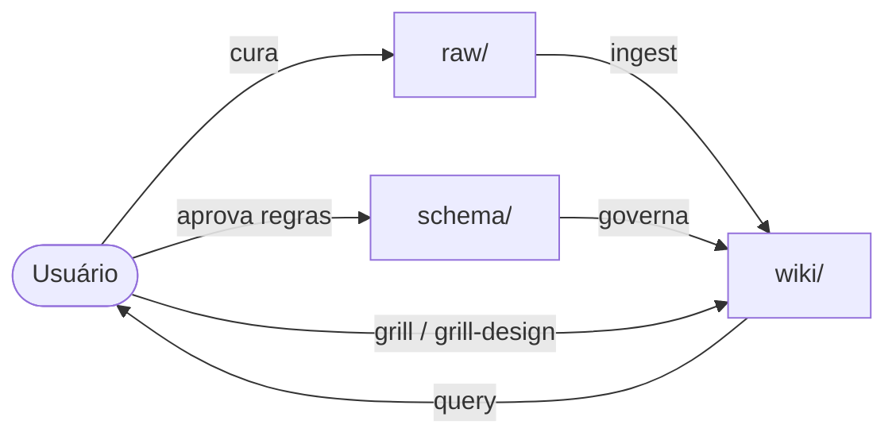

# Arquitetura RWS

Baseada em [LLM Wiki — Andrej Karpathy](https://gist.github.com/karpathy/442a6bf555914893e9891c11519de94f).

## Por que não RAG puro

Em RAG o LLM redescobre o conhecimento do zero a cada pergunta: nada acumula.
Na RWS o agente **compila** o conhecimento uma vez numa wiki persistente e a **mantém atualizada**.
Cross-references já existem, contradições já foram sinalizadas, a síntese já reflete tudo o que foi lido.
A wiki é um **artefato que se acumula (compounding)**.

> O humano cura fontes, direciona a análise e faz boas perguntas. O agente faz todo o resto:
> resumir, cruzar referências, arquivar e manter a contabilidade.

## As três camadas

### 1. Raw Sources — `raw/`
- Fontes curadas: artigos, transcrições, specs, prints, dumps, snapshots de código, threads.
- **Imutáveis.** O agente lê, nunca modifica. É a fonte da verdade.
- Cada fonte tem metadados (ver [templates/raw/raw-source-meta.md](../templates/raw/raw-source-meta.md)).
- Fontes descartadas vão para `raw/_archive/` (nunca são apagadas).

### 2. Wiki — `wiki/`
- Markdown gerado e mantido pelo agente: entidades, conceitos, decisões, specs de UI, sínteses.
- Duas páginas especiais: `index.md` (catálogo por conteúdo) e `log.md` (cronologia append-only). Ver [index-and-log.md](./index-and-log.md).
- Ligações com `[[wikilinks]]` (compatível com Obsidian).
- O usuário lê; o agente escreve.

### 3. Schema — `schema/`
- `schema/schema.md`: estrutura de pastas, tipos de página, frontmatter obrigatório, workflows do projeto.
- `schema/design-system.md` (opcional): regras visuais gerado por `/grill-design`.
- Outras regras específicas (`schema/<regra>.md`).
- É o que torna o agente um **mantenedor disciplinado** em vez de um chatbot genérico.
- Os arquivos de agente (`CLAUDE.md`, `AGENTS.md`, `GEMINI.md`) do projeto apontam para `schema/schema.md`.

## Layout no projeto do usuário

```
<projeto>/
├── raw/
│   ├── _archive/
│   ├── assets/                # imagens baixadas
│   └── 2026-10-16-codebase-audit.md
├── wiki/
│   ├── index.md
│   ├── log.md
│   ├── overview.md
│   ├── entities/
│   ├── concepts/
│   ├── decisions/
│   ├── ui-specs/
│   └── syntheses/
├── schema/
│   ├── schema.md
│   └── design-system.md
└── CLAUDE.md | AGENTS.md | GEMINI.md   → "Leia schema/schema.md e siga a skill RWS"
```

> A localização pode ser customizada (ex.: `docs/rws/`). Se for, o caminho fica declarado em `schema/schema.md` e o agente obedece.

## Fluxo de informação



## Operações (detalhes em [lifecycle.md](./lifecycle.md))

| Operação | Resumo |
|---|---|
| **Ingest** | Nova fonte → resumo → atualiza 5-15 páginas → index → log |
| **Query** | index → páginas → raw → resposta com citações → (opcional) vira página |
| **Lint** | Contradições, páginas órfãs, claims obsoletos, conceitos sem página, links quebrados |
| **Grill** | Entrevista → aprovação → wiki + schema |
