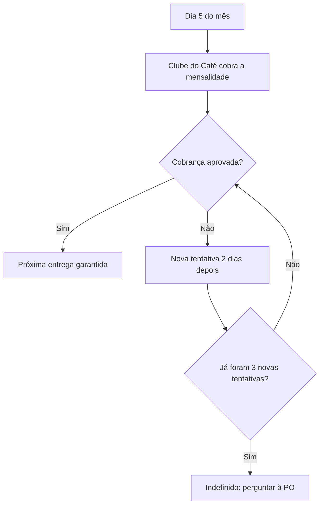

# Cobrança mensal

Todo mês o Clube do Café cobra a mensalidade de cada assinatura ativa no cartão do [[assinante]]. Termos conforme o [[glossario]].

## Gatilho
Chega o dia 5 do mês.

## Resultado esperado
A mensalidade foi recebida e a próxima entrega do assinante está garantida.

## Atores
- [[assinante]] — tem a mensalidade cobrada no cartão.

## Como deve ser

## Passos e regras aplicadas
| # | Passo | Quem | Regras aplicadas |
|---|---|---|---|
| 1 | Cobrar a mensalidade de cada assinatura ativa no dia 5 | Clube do Café | [[br-001-cobranca-no-dia-5]] |
| 2 | Se a cobrança for recusada, tentar de novo a cada 2 dias, até 3 vezes | Clube do Café | [[br-002-novas-tentativas-de-cobranca]] |
| 3 | Com a cobrança aprovada, garantir a próxima entrega | Clube do Café | — |

## Exceções
| Situação | O que deve acontecer | Regra |
|---|---|---|
| A 3ª nova tentativa também é recusada | ⚠️ Não definido — perguntar à PO | — |

> [!WARNING] Não verificado
> O destino da assinatura após a 3ª nova tentativa recusada não foi decidido na reunião de kickoff.
