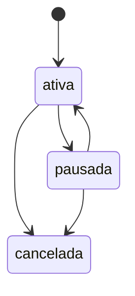

# Assinatura

Vínculo entre um cliente e um plano mensal de café.

## Estados

## Regras
- É cobrada pela [[cobranca-recorrente]] ([fonte](../../raw/2026-10-16-reuniao-kickoff.md#decisões)).
- O cliente pode pausar pelo [[painel-do-assinante]].
