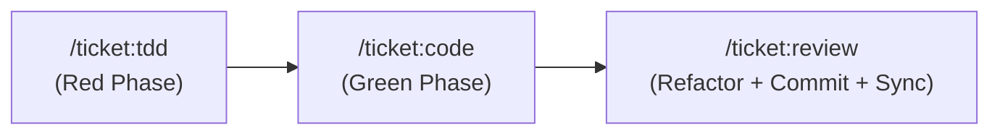

# /implement

**Objetivo:** orquestrar a construção mecânica de software partindo de especificações persistentes na wiki, aplicando o ciclo completo de TDD até a entrega final com histórico limpo e rastreável.

## Formas de Acionamento

| Invocação | Comportamento |
|---|---|
| `/implement <slug-ou-id>` | Executa a task específica diretamente (ex.: `/implement webhook-stripe` ou `/implement #42`). |
| `/implement vertical:<nome>` | Filtra as tasks pendentes daquela verticalidade e executa a de maior prioridade/sem bloqueios. |
| `/implement` ou `/implement --roadmap` | Analisa todo o roadmap de tasks da wiki, determina a próxima tarefa viável e executa. |

---

## Passos

### 1. Resolução do Alvo e Análise de Roadmap

1. **Se informado um ticket específico**:
   - Localizar `wiki/tasks/<slug>.md`.
   - Verificar se as dependências declaradas em `depends_on` estão com `status: completed`.
   - Se houver pendências não concluídas, alertar o usuário antes de prosseguir.

2. **Se informado `vertical:<nome>` ou sem argumentos (modo Roadmap)**:
   - Fazer varredura de todos os arquivos em `wiki/tasks/*.md` com `status: planned`.
   - Se `vertical:` foi especificado, filtrar apenas as tasks pertencentes àquela vertical.
   - Construir a ordenação lógica:
     1. Tasks com **todas as dependências (`depends_on`) já concluídas** (`status: completed`);
     2. Ordenadas por nível de prioridade (`high` > `medium` > `low`);
     3. Ordem de criação (`created`).
   - Apresentar o roadmap resumido ao usuário:
     ```markdown
     ### Roadmap de Execução: <vertical ou geral>
     1. 🟢 [[task-proxima]] (Prioridade: high · Dependências resolvidas) 👈 Alvo atual
     2. ⏳ [[task-futura]] (Aguardando conclusão de [[task-proxima]])
     ```
   - Se houver mais de uma task desimpedida com mesma prioridade, usar pergunta de múltipla escolha com a recomendação em primeiro lugar.

---

### 2. Pipeline de Execução (TDD → Code → Review)

Uma vez definido o `<slug>` da task, o orquestrador executa as 3 etapas em sequência ininterrupta:



1. **Fase RED — [/ticket:tdd](../ticket-tdd/SKILL.md)**:
   - Altera status para `in_progress` (na wiki e issue GitHub).
   - Escreve os testes unitários/integrados cobrindo critérios de aceite e casos de borda.
   - Roda a suíte de testes e valida que os novos testes falham pelo motivo correto.

2. **Fase GREEN — [/ticket:code](../ticket-code/SKILL.md)**:
   - Implementa a lógica no código de produção respeitando o `schema/schema.md`.
   - Roda a suíte iterativamente até atingir **100% de testes verdes**.
   - Assegura que nenhum teste preexistente sofreu regressão.

3. **Fase REFACTOR & SYNC — [/ticket:review](../ticket-review/SKILL.md)**:
   - Roda linters e verificadores estáticos do projeto.
   - Refatora duplicações e simplifica a implementação mantendo os testes verdes.
   - Cria o commit estritamente convencional:
     `git commit -m "<tipo>(<vertical>): <descrição> (#<issue>)"`
   - Atualiza `wiki/tasks/<slug>.md` para `status: completed`.
   - Atualiza entidades afetadas com [/wiki:increment](../wiki-increment/SKILL.md).
   - Fecha a issue no GitHub com comentário e label `status:done`.
   - Registra o encerramento em `wiki/log.md`.

---

### 3. Conclusão e Próximo Passo

Ao concluir o pipeline:
- Informar o resultado da entrega (testes verdes, commit gerado, issue fechada).
- Se estiver rodando no escopo de uma vertical com outras tasks planejadas, perguntar se deseja avançar para o próximo item do roadmap:
  *"Deseja executar a próxima task: `[[slug-da-proxima-task]]`? (/implement [[slug-da-proxima-task]])"*.
