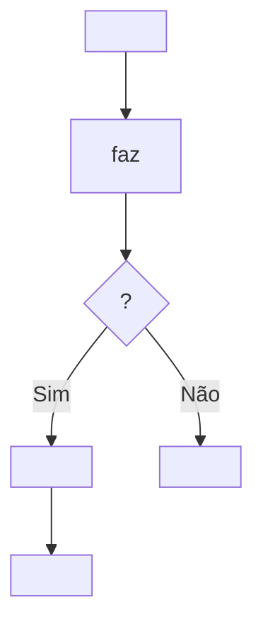

# <Nome do processo>

<Resumo de 1-3 frases do processo, usando os termos do [[glossario]].>

## Gatilho
<O acontecimento de negócio que inicia o processo. Ex.: "O cliente solicita o cancelamento do contrato.">

## Resultado esperado
<Como o negócio fica quando o processo termina bem.>

## Atores
- [[<slug-do-ator>]] — <papel no processo>

## Como é hoje
<!-- Somente passos de negócio: quem faz o quê. Nada de sistemas, apenas pessoas e decisões de negócio. -->

## Como deve ser
<!-- Mesmo formato. Destaque o que muda em relação a "Como é hoje". -->

## Passos e regras aplicadas
| # | Passo | Quem | Regras aplicadas |
|---|---|---|---|
| 1 | <Passo> | [[<slug-do-ator>]] | [[br-001-<slug>]] |
| 2 | <Passo> | [[<slug-do-ator>]] | — |

## Exceções
<!-- Desvios do caminho principal e como o negócio deve tratá-los -->
| Situação | O que deve acontecer | Regra |
|---|---|---|
| <Situação excepcional> | <Tratamento esperado> | [[br-002-<slug>]] |
