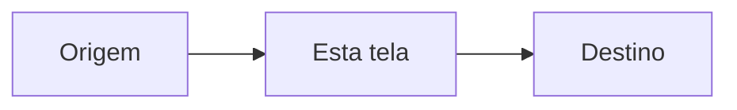

# <Tela ou fluxo>

<Resumo: o que o usuário faz aqui e qual resultado obtém.>

## Público e contexto
| Item | Valor |
|---|---|
| Persona | |
| Frequência de uso | |
| Dispositivo principal | desktop / mobile / ambos |
| Objetivo principal | |

## Jornada


## Patterns adotados
| Pattern | Onde | Referência | Motivo |
|---|---|---|---|
| Data table + filtros facetados | Lista de pedidos | Stripe Dashboard | Público operacional compara valores |

## Referências (apps correlatos)
| App | O que copiar | O que evitar |
|---|---|---|

## Wireframe
```
┌───────────────────────────────────────────┐
│ Header                                    │
├──────────┬────────────────────────────────┤
│ Sidebar  │ Conteúdo                       │
└──────────┴────────────────────────────────┘
```

## Componentes
| Componente | Biblioteca / origem | Variações | Observações |
|---|---|---|---|

## Matriz de estados
| Componente | Loading | Vazio | Erro | Sucesso | Sem permissão |
|---|---|---|---|---|---|

## Interações e feedback
- 

## Acessibilidade
- [ ] Navegável por teclado, ordem de foco lógica
- [ ] Contraste AA
- [ ] Rótulos/ARIA em controles sem texto
- [ ] Respeita `prefers-reduced-motion`

## Microcopy
| Local | Texto |
|---|---|

## Responsividade
| Breakpoint | Comportamento |
|---|---|

## Perguntas em aberto
- 
